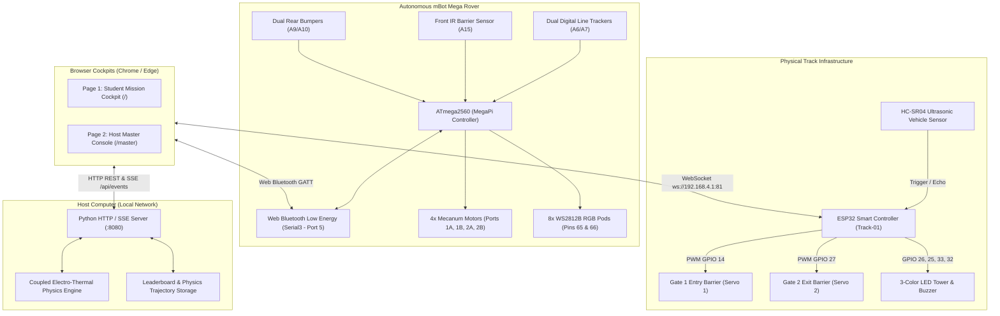

# Autonomous mBot Mega EV Rover & Smart Dual-Gate Track Hub
### Texas Tech University — Smart Human-centric Automation Resilience (SHARE) Lab

[](LICENSE)
[](https://react.dev/)
[](https://www.typescriptlang.org/)
[](https://www.python.org/)
[](https://www.espressif.com/)
[](https://www.makeblock.com/)

A cyber-physical robotics exhibit testbed designed for STEM education and robotics research. The system integrates an omnidirectional mecanum-wheel rover (**Makeblock mBot Mega**), an IoT roadway infrastructure controller (**ESP32 Dual-Gate Controller**), an electro-thermal battery physics simulation engine, and a dual-view web cockpit supporting Web Bluetooth, WebSockets, and Server-Sent Events (SSE).

---

## System Architecture



---

## 1. Dashboard Build & Setup Steps

The web dashboard is built with **React 19**, **TypeScript**, **Vite**, and **Tailwind CSS**. It is served by a lightweight Python multi-client synchronization hub that executes the electro-thermal battery model and broadcasts real-time telemetry to all student kiosks and host tablets via Server-Sent Events (SSE).

### Prerequisites
* **Python 3.10+** (64-bit recommended)
* **Node.js v18.0+** and **npm** (for compiling the frontend)
* **Google Chrome** or **Microsoft Edge** (required for the **Web Bluetooth API**)

---

### Step 1.1: Clone the Repository
```bash
git clone https://github.com/Ahnaf-Muizz/autonomous-ev-smart-track-hub.git
cd autonomous-ev-smart-track-hub
```

---

### Step 1.2: Install Dependencies & Build the Frontend Webapp

Navigate to the `webapp/` directory, install Node packages, and build the distribution bundle:

```bash
# Navigate to webapp directory
cd webapp

# Install dependencies (React 19, Lucide, Tailwind CSS, Vite)
npm install

# Compile production bundle (outputs to ../dashboard/dist)
npm run build

# Return to root directory
cd ..
```

> **Note:** The Vite build output is directly written into `dashboard/dist/`. The Python server automatically serves this production bundle to any connected browser.

---

### Step 1.3: Start the Backend & Multi-PC Sync Server

You have two convenient ways to start the server:

#### Option A: 1-Click Batch Script (Windows)
Double-click **`start_dashboard.bat`** (or run `.\start_dashboard.bat` in Command Prompt / PowerShell).
This script automatically:
1. Audits your Python runtime (`python` or `py`).
2. Clears any orphaned processes on port `8080`.
3. Verifies that `dashboard/dist/index.html` exists.
4. Starts the server on port `8080`.

#### Option B: Direct Terminal Command (Cross-Platform)
```bash
# Windows (using official Python launcher)
py server/server.py 8080

# Windows / macOS / Linux (standard python3)
python3 server/server.py 8080
```

---

### Step 1.4: Open the Web Interfaces

Once started, open **Google Chrome** or **Microsoft Edge** and navigate to:

| Interface | URL | Purpose |
| :--- | :--- | :--- |
| **Student Mission Kiosk** | `http://localhost:8080/` | Interactive 4-phase mission: Launch, Autonomous Navigation, Supercharger Game, Lap Finish. |
| **Master Host Console** | `http://localhost:8080/master` | Password-protected (`sharelab`) admin console: WASD teleoperation, speed, sensor interlocks, RGB studio, physics graphs. |
| **Tablet / LAN Access** | `http://<HOST-IP>:8080/` | Multi-PC / iPad / Tablet access across the same Wi-Fi router. |

---

### Step 1.5: SSL Certificate Installation (For Multi-Device Web Bluetooth)

Google Chrome requires a secure context (**HTTPS** or `localhost`) to enable the **Web Bluetooth API**.
* If you run Chrome directly on the host machine hosting `localhost:8080`, Web Bluetooth works immediately.
* If connecting a remote tablet or student laptop to the host machine over LAN:
  1. Run **`trust_certificate.bat`** (installs `server/cert.pem` into the Windows Trusted Root Certification Authorities store).
  2. Launch the server in HTTPS mode on port `8443` or access the secure endpoint.

---

## 2. Wiring & Pinouts for Makeblock mBot Mega

The **mBot Mega** is powered by the **Makeblock MegaPi** micro-controller board, based on the **ATmega2560** operating at 16 MHz. It utilizes an omnidirectional 4-wheel Mecanum drive system, dual digital line sensors, front optical barrier detection, mechanical collision bumpers, and dual WS2812B RGB lighting pods.

```
                  +-----------------------------------+
                  |        Makeblock MegaPi           |
                  |          (ATmega2560)             |
                  +-----------------------------------+
                   |         |          |          |
               [Port 1A] [Port 1B]  [Port 2A]  [Port 2B]
                  FR        RR         RL         FL
                Motor     Motor      Motor      Motor
```

### 2.1 Motor & Mecanum Wheel Mapping

The 4 DC encoder motors connect to the MegaPi dual-channel driver boards as follows:

| Motor Location | Driver Port | MegaPi Constant | Drive Function |
| :--- | :--- | :--- | :--- |
| **Front-Right (FR)** | Port 1, Slot A | `PORT1A` | Right-side forward / strafe / yaw |
| **Rear-Right (RR)** | Port 1, Slot B | `PORT1B` | Right-side forward / strafe / yaw |
| **Rear-Left (RL)** | Port 2, Slot A | `PORT2A` | Left-side forward / strafe / yaw |
| **Front-Left (FL)** | Port 2, Slot B | `PORT2B` | Left-side forward / strafe / yaw |

> **Mecanum Wheel Roller Orientation (X-Pattern):**
> Looking down from the top of the chassis, the rollers touching the ground must form an **"X"** pattern. The rollers on diagonally opposite wheels point toward the center of the robot.

---

### 2.2 Sensor & Lighting Pinout Summary

| Subsystem | MegaPi Pin | ATmega2560 Pin | Direction / Logic | Function |
| :--- | :--- | :--- | :--- | :--- |
| **Line Sensor (Left)** | `A6` | Pin 91 (PF6) | Digital Input | Boundary sensor (`LOW` = black tape, `HIGH` = white floor) |
| **Line Sensor (Right)** | `A7` | Pin 90 (PF7) | Digital Input | Boundary sensor (`LOW` = black tape, `HIGH` = white floor) |
| **Front Obstacle / Gate** | `A15` | Pin 82 (PK7 / D69) | Analog Input | Front optical barrier (`ADC < 350` = barrier blocked) |
| **Rear Left Bumper** | `A9` | Pin 88 (PK1 / D63) | Input Pullup | Limit switch (`LOW` = bumper depressed) |
| **Rear Right Bumper** | `A10` | Pin 87 (PK2 / D64) | Input Pullup | Limit switch (`LOW` = bumper depressed) |
| **RGB Pod (Right Side)** | Pin `65` (`A11`) | Pin 86 (PK3) | Digital Output | 4x WS2812B RGB Smart LEDs |
| **RGB Pod (Left Side)** | Pin `66` (`A12`) | Pin 85 (PK4) | Digital Output | 4x WS2812B RGB Smart LEDs |
| **Bluetooth Module** | Port 5 | `Serial3` (D14/D15)| UART @ 115200 | Web Bluetooth GATT communication with dashboard |
| **USB Serial Monitor** | USB Port | `Serial` (D0/D1) | UART @ 115200 | Firmware flashing & real-time debug telemetry |

---

### 2.3 Flashing mBot Mega Firmware

1. Install the **Arduino IDE** (v1.8.x or v2.x).
2. Install the **Makeblock Library**:
   * In Arduino IDE: **Sketch** → **Include Library** → **Manage Libraries...**
   * Search for `Makeblock` and install `Makeblock-Libraries` by Makeblock.
3. Open `mbot_mega_firmware/mbot_mega_firmware.ino`.
4. In the **Tools** menu, select:
   * **Board:** `Arduino Mega or Mega 2560`
   * **Processor:** `ATmega2560 (Mega 2560)`
   * **Port:** Select the COM port of your MegaPi.
5. Click **Upload**.

---

## 3. Wiring & Pinouts for ESP32 Dual-Gate Smart Controller

The **ESP32 Dual-Gate Controller** acts as the automated roadway infrastructure. It broadcasts an isolated Wi-Fi Access Point (`ESP32_Gate_Network`), hosts a WebSocket server on port `81`, operates Gate 1 (entry barrier via ultrasonic vehicle detection), operates Gate 2 (exit barrier via dashboard WebSocket trigger), and drives a 3-color LED traffic light tower and sounder.

```
                            +--------------------+
                            |   ESP32 DevKit     |
                            +--------------------+
                              |   |   |   |   |
                    +---------+   |   |   |   +---------+
                    |             |   |   |             |
                 [GPIO 14]        |   |   |          [GPIO 27]
                  Gate 1          |   |   |           Gate 2
                  Servo           |   |   |           Servo
                             +----+   |   +----+
                             |        |        |
                         [GPIO 13]    |    [GPIO 32]
                         HC-SR04      |     Passive
                         Trigger      |     Buzzer
                                  [GPIO 12]
                                  HC-SR04
                                    Echo
                               (via 3.3V divider)
```

### 3.1 ESP32 Complete Pinout Table

| Component | ESP32 GPIO | Signal Type | Electrical Notes |
| :--- | :--- | :--- | :--- |
| **HC-SR04 Ultrasonic Trigger** | **GPIO 13** | Digital Output | 10 µs pulse to initiate measurement |
| **HC-SR04 Ultrasonic Echo** | **GPIO 12** | Digital Input | **Requires Voltage Divider** (5V to 3.3V) |
| **Gate 1 Entry Servo (S1)** | **GPIO 14** | PWM Output | Open: $0^\circ$, Closed: $90^\circ$ (Auto-closes after 20s) |
| **Gate 2 Exit Servo (S2)** | **GPIO 27** | PWM Output | Open: $180^\circ$, Closed: $90^\circ$ (Auto-closes after 10s) |
| **Red LED Tower** | **GPIO 26** | Digital Output | Active HIGH (Current-limiting $220\,\Omega$ resistor) |
| **Yellow LED Tower** | **GPIO 25** | Digital Output | Active HIGH (Current-limiting $220\,\Omega$ resistor) |
| **Green LED Tower** | **GPIO 33** | Digital Output | Active HIGH (Current-limiting $220\,\Omega$ resistor) |
| **Passive Piezo Buzzer** | **GPIO 32** | PWM / Tone | Sound cues for car detection and gate open |

---

### 3.2 Ultrasonic Echo Voltage Divider Circuit

The HC-SR04 ultrasonic sensor operates at $5\,\text{V}$ VCC and outputs a $5\,\text{V}$ logic pulse on its `ECHO` pin. Because the ESP32 GPIO pins are rated for $3.3\,\text{V}$ maximum, use a simple two-resistor voltage divider:

```
  HC-SR04 ECHO (5V) -----> [ 1.0 kΩ ] ----+----> ESP32 GPIO 12 (3.3V)
                                           |
                                       [ 2.0 kΩ ]
                                           |
                                          GND
```

---

### 3.3 Servo Power & Jitter Protection

* **Power Rail:** Power the two SG90 / MG90S servos from an external **$5\,\text{V}$ / $2\,\text{A}$ power supply**. Tie the external power ground directly to the **ESP32 GND**. Do **not** power servos directly from the ESP32 3.3V pin.
* **Firmware Anti-Jitter:** Standard analog micro-servos tend to chatter and jitter under continuous PWM. The firmware in `GateServos.cpp` uses an active 50 ms travel window (`SERVO_TRAVEL_MS = 50`) and then automatically detaches the PWM pin (`servo.detach()`), holding the barrier arm firmly in place with zero gear chatter.

---

### 3.4 Flashing ESP32 Firmware

1. In Arduino IDE: **File** → **Preferences**, add the ESP32 board manager URL:
   ```
   https://raw.githubusercontent.com/espressif/arduino-esp32/gh-pages/package_esp32_index.json
   ```
2. In **Tools** → **Board** → **Boards Manager...**, install `esp32` by Espressif Systems.
3. Install required libraries:
   * **`WebSockets`** by Markus Sattler (v2.4.x+)
   * **`ESP32Servo`** by Kevin Harrington (v3.0.x+)
4. Open `esp32_gate_firmware/esp32_gate_firmware.ino`.
5. Under **Tools**, select:
   * **Board:** `ESP32 Dev Module`
   * **Upload Speed:** `921600`
   * **Flash Frequency:** `80MHz`
   * **Port:** Select your ESP32 COM port.
6. Press the **BOOT** button on the ESP32 when `Connecting......` appears in the console, and click **Upload**.

---

## 4. Wireless Communication Matrix

| Channel | Protocol | Hardware / Address | Payload / Data Flow |
| :--- | :--- | :--- | :--- |
| **Rover Teleoperation** | Web Bluetooth Low Energy (GATT) | Makeblock BLE Module (Port 5 / Serial3) | Single-char teleop (`w`, `a`, `s`, `d`, ` `), speed (`j`, `k`, `u`), RGB (`#RRGGBB`), mode (`1`, `2`). |
| **Track Gate Control** | WebSocket (RFC 6455) | `ws://192.168.4.1:81` (`ESP32_Gate_Network`) | JSON commands: `{"cmd":"open_gate2"}`, `{"cmd":"get_state"}`. |
| **Multi-PC Telemetry** | Server-Sent Events (SSE) | `http://localhost:8080/api/events` | Broadcasts car count, gate states, speed records, and mission status. |
| **Physics Simulation** | HTTP REST POST | `http://localhost:8080/api/charge` | Simulates coupled 2-state ECM + dual thermal mass battery response. |

---

## 5. Master Console Teleoperation Cheat Sheet

When operating from the **Master Host Console** (`/master`), the rover can be controlled using direct keyboard commands or touchscreen buttons:

| Key | Action | Response |
| :---: | :--- | :--- |
| **`W`** | Drive Forward | Continuous forward drive at current PWM speed |
| **`S`** | Drive Backward | Reverse drive |
| **`A`** | Strafe Left | Lateral crab-walk left (zero rotation) |
| **`D`** | Strafe Right | Lateral crab-walk right (zero rotation) |
| **`Space`** | Immediate Halt | Sets all 4 motor PWM duties to 0 |
| **`1`** | Mode 1 (Autonomous) | Engages black line follower & docking sequence |
| **`2`** | Mode 2 (Manual) | Switches to manual WASD teleoperation |
| **`U`** | Faster (+10) | Increases manual speed by +10 PWM (up to 255) |
| **`J`** | Slower (-10) | Decreases manual speed by -10 PWM (down to 40) |
| **`K`** | Reset Speed | Restores manual speed to default 100 PWM |
| **`8`** | Toggle Boundary Safety | Mutes / Unmutes IR black line track edge interlock |
| **`9`** | Toggle Barrier Safety | Mutes / Unmutes ultrasonic & front obstacle interlock |
| **`B`** | Toggle Bumper Safety | Mutes / Unmutes rear mechanical collision switches |
| **`T`** | Tabletop Master Toggle | Toggles all 3 safety interlocks simultaneously |
| **`L`** | Line Sensor Raw Diagnostic | Queries raw reflectance states of line sensors |

---

## 6. Project Directory Tree

```
autonomous-ev-smart-track-hub/
├── README.md                                # This complete setup and wiring guide
├── start_dashboard.bat                      # 1-click Windows runtime auditor and launcher
├── trust_certificate.bat                    # SSL certificate installer for trusted Web Bluetooth
├── SYSTEM_WALKTHROUGH.md                    # Deep-dive system architecture specification
│
├── server/                                  # Backend Synchronization Hub & Physics
│   ├── server.py                            # HTTP, SSE & REST API server (:8080)
│   ├── battery_physics.py                   # Coupled 2-state ECM + dual thermal mass model
│   ├── leaderboard.json                     # Persistent high-score store
│   └── game_history.json                    # Full discrete physics trajectories
│
├── webapp/                                  # Frontend Source (React 19 + TypeScript + Vite)
│   ├── src/
│   │   ├── components/
│   │   │   ├── MasterHostConsole.tsx        # Master control cockpit & teleoperation
│   │   │   ├── BatterySuperchargerView.tsx  # Interactive supercharger mini-game
│   │   │   └── CircularTrackCanvas.tsx      # Real-time animated track view
│   │   ├── services/
│   │   │   ├── hardware.ts                  # Web Bluetooth GATT & ESP32 WebSocket manager
│   │   │   └── batteryPhysics.ts            # Client physics integration
│   │   ├── App.tsx                          # Root application component
│   │   └── main.tsx                         # React entry point
│   ├── package.json                         # Node dependencies & build scripts
│   └── vite.config.ts                       # Vite configuration
│
├── dashboard/                               # Compiled Distribution Output
│   └── dist/                                # Production web assets served by server.py
│
├── mbot_mega_firmware/                      # Makeblock mBot Mega Arduino Firmware
│   ├── mbot_mega_firmware.ino               # Main entry point & mode scheduler
│   ├── Config.h                             # Pin assignments, speed limits, & timings
│   ├── Motors.cpp / .h                      # Mecanum kinematics & PWM dithering
│   ├── LineSensor.cpp / .h                  # Dual digital line follower logic
│   ├── BarrierSensor.cpp / .h               # Front obstacle optical sensor
│   ├── CollisionSensor.cpp / .h             # Rear mechanical limit switches
│   ├── LEDs.cpp / .h                        # WS2812B RGB animations & status pods
│   ├── manual_mode.cpp / .h                 # Mode 2 teleoperation & interlocks
│   └── line_follower_mode.cpp / .h          # Mode 1 autonomous line follower
│
└── esp32_gate_firmware/                     # ESP32 Smart Dual-Gate Firmware
    ├── esp32_gate_firmware.ino              # Main controller loop & SoftAP setup
    ├── Config.h                             # GPIO pinouts, servo angles, & credentials
    ├── GateServos.cpp / .h                  # SG90/MG90S servo PWM control & anti-jitter
    ├── GateWebSocket.cpp / .h               # RFC 6455 WebSocket server (port 81)
    ├── Ultrasonic.cpp / .h                  # HC-SR04 distance measurement
    ├── LEDs.cpp / .h                        # 3-color light tower sequencer
    └── Buzzer.cpp / .h                      # Piezo chime & frequency generator
```

---

## 7. License & Credits

Developed by the **Smart Human-centric Automation Resilience (SHARE) Lab** at **Texas Tech University**.

Distributed under the MIT License. Contributions and educational usage are welcome!
