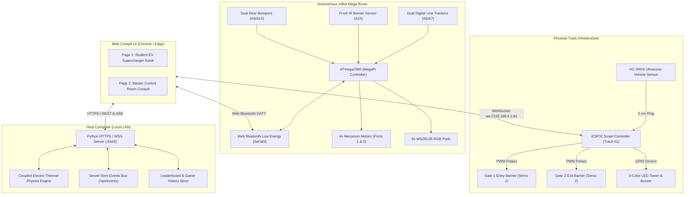
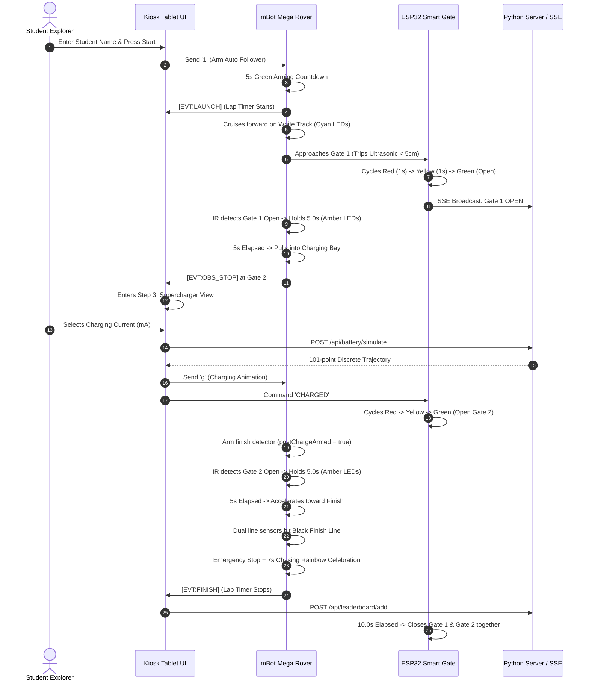

# Texas Tech University — SHARE Lab
# Autonomous mBot Mega EV Rover & Smart Dual-Gate Track Hub
## Complete Subsystem Walkthrough, Hardware Assembly, Wireless Setup, and Dashboard Navigation Tutorial

---

## 1. Executive System Overview

The **Texas Tech SHARE Lab EV Rover Track System** is an interactive, multi-device cyber-physical testbed designed for robotics research, battery management education, and STEM outreach. 

The testbed merges an omnidirectional mobile robot, smart IoT roadway infrastructure, an electro-thermal physics simulation engine, and a dual-view web application into a synchronized real-time loop:



---

## 2. Track Layout & Operational Lifecycle

The track is an oval or rounded-rectangle tabletop course marked with a white reflective interior surface and a black vinyl boundary tape.

```
       [ GATE 1: Entry Barrier ]       [ EV SUPERCHARGER BAY ]      [ GATE 2: Exit Barrier ]
               (Pin 14)                   (T1 Thermal Hold)                  (Pin 27)
         ====================          ======================          ====================
        /                                                                                  \
       |                                                                                    |
  [Left Turn]                                                                          [Right Turn]
       |                                                                                    |
        \                                                                                  /
         ==================================================================================
                                    [ START / FINISH LINE ]
                                  (Dual Black Tape Marks)
```

### The 4-Stage Mission Cycle

1. **Stage 1 — Start Line & Arming:**
   - Rover is positioned on the safe white track behind the finish line.
   - Student enters their name on the tablet and presses **Start Rover Mission**.
   - Rover verifies dual boundary sensors are on white (`A6=1, A7=1`) and initiates a **5-second flashing green arming countdown**.
2. **Stage 2 — Gate 1 Approach & Collision-Free Entry:**
   - Rover cruises forward with solid cyan headlights at base speed 70.
   - At Gate 1, the ultrasonic sensor detects the rover within 5 cm.
   - ESP32 cycles the 3-color light tower: **Red (1.0s) $\rightarrow$ Yellow (1.0s) $\rightarrow$ Green (Open)**.
   - Gate 1 barrier arm swings up (0° vertical) and detaches its PWM train.
   - Rover's front IR sensor detects the obstacle has cleared, flashes amber caution LEDs, and **holds stationary for exactly 5.0 seconds** to ensure the barrier is fully clear.
   - Rover cruises into the charging bay. Gate 1 remains open.
3. **Stage 3 — Supercharger Battery Game:**
   - Rover halts at closed Gate 2. Webapp switches to Step 3 with flashing cyan LEDs (`'c'`).
   - Student chooses charging current ($mA$) using the slider based on battery capacity and time window.
   - During the 10-second charging animation, rover pulses green LEDs (`'g'`). Real-time core temperature ($T_1$) and SOC are graphed.
   - Upon successful charge without thermal runaway ($T_1 < 61.85^\circ\text{C}$):
     - Webapp transmits `'e'` (Charge Success) to rover $\rightarrow$ Rover arms its finish-line detector (`postChargeArmed = true`).
     - Webapp transmits `CHARGED` to ESP32 $\rightarrow$ ESP32 opens Gate 2.
     - **Rover holds stationary for 5.0 seconds** after Gate 2 opens before moving.
     - Gate 1 and Gate 2 close together after the 10.0-second passage timer expires.
4. **Stage 4 — Final Sprint & Checkered Victory:**
   - Rover drives through Gate 2 toward the checkered finish line.
   - When both boundary sensors detect the black finish line (`A6=0, A7=0`), the rover stops motors immediately.
   - Rover executes a **7-second fast chasing rainbow celebration** across both 4-LED pods.
   - Final lap time, charging speed, and thermal efficiency are submitted to the live leaderboard.

---

## 3. Subsystem Hardware Specifications & Wiring

### 3.1. Subsystem A: mBot Mega Rover (Makeblock MegaPi / ATmega2560)

The mBot Mega utilizes an ATmega2560 MCU running at 16 MHz with 8 KB SRAM, driving 4 encoded DC motors through dual MegaPi H-bridge driver chips.

```
                  +-----------------------------------+
                  |         Makeblock MegaPi          |
                  |           (ATmega2560)            |
                  +-----------------------------------+
                     |       |       |       |     |
            +--------+   +---+---+   |   +---+---+ +--------+
            |            |       |   |   |       |          |
         Port 1A      Port 1B    |  Port 2A   Port 2B     Serial3
        (Front-R)     (Rear-R)   |  (Rear-L)  (Front-L)  (Bluetooth)
                                 |
        +------------------------+--------------------------+
        |            |           |             |            |
      Pin 65       Pin 66      Pin A15       Pin A6/A7   Pin A9/A10
      Right Pod    Left Pod    Front IR      Line Sens   Rear Bumpers
      (WS2812B)   (WS2812B)   (Barrier)      (Left/Right) (RL / RR)
```

#### Complete MegaPi Pinout Table

| Pin Identifier | MegaPi Physical Port | Hardware Component | Function / Logic Levels |
|:---|:---|:---|:---|
| **Port 1 - Slot A** | Motor Driver 1A | Front-Right Mecanum Motor | PWM Speed + Direction |
| **Port 1 - Slot B** | Motor Driver 1B | Rear-Right Mecanum Motor | PWM Speed + Direction |
| **Port 2 - Slot A** | Motor Driver 2A | Rear-Left Mecanum Motor | PWM Speed + Direction |
| **Port 2 - Slot B** | Motor Driver 2B | Front-Left Mecanum Motor | PWM Speed + Direction |
| **Pin 65 (A11)** | RJ25 Adapter / Header | Right LED Pod (4x WS2812B) | Single-wire NRZ serial data |
| **Pin 66 (A12)** | RJ25 Adapter / Header | Left LED Pod (4x WS2812B) | Single-wire NRZ serial data |
| **Pin 69 (A15)** | Port 6 Analog / Digital | Front IR Barrier Sensor | Active-LOW ($< 350$ ADC = Obstacle) |
| **Pin A6** | Port 7 Digital Input | Left Line Follower Sensor | $0 = \text{Black Line}, 1 = \text{White Surface}$ |
| **Pin A7** | Port 7 Digital Input | Right Line Follower Sensor | $0 = \text{Black Line}, 1 = \text{White Surface}$ |
| **Pin 63 (A9)** | Port 8 Digital Input | Rear-Left Limit Bumper Switch | Active-LOW (`INPUT_PULLUP`) |
| **Pin 64 (A10)** | Port 8 Digital Input | Rear-Right Limit Bumper Switch | Active-LOW (`INPUT_PULLUP`) |
| **Serial3 TX/RX** | Onboard BLE Socket | Me Bluetooth Module (Dual-Mode) | 115200 Baud UART, 8-N-1 |
| **Serial0 USB** | Type-B USB Port | FTDI USB-UART Bridge | 115200 Baud Serial Monitor |

---

### 3.2. Subsystem B: ESP32 Smart Dual-Gate Controller

The gate controller runs on a 30-pin or 38-pin **ESP32 DevKit V1** (ESP-WROOM-32). All connections are routed exclusively along the **VIN-side header rail** to maintain an isolated single-rail layout.

```
       +--------------------------------------------------------+
       |                  ESP32 DevKit V1 Rail                  |
       +--------------------------------------------------------+
          |      |      |      |      |      |      |      |
        GPIO13 GPIO12 GPIO14 GPIO27 GPIO26 GPIO25 GPIO33 GPIO32
          |      |      |      |      |      |      |      |
        Trig    Echo   Servo1 Servo2  Red   Yellow Green  Buzzer
        [HC-SR04]      [Gate1] [Gate2] [----- Light Tower -----]
```

#### Complete ESP32 Pinout & Component Wiring

| ESP32 Pin | Target Component | Wire Color Recommendation | Operating Voltage & Interfacing |
|:---|:---|:---|:---|
| **GPIO 13** | HC-SR04 Trigger | Blue | 3.3V Logic Output directly to Trig |
| **GPIO 12** | HC-SR04 Echo | Green | **3.3V Level-Shifted** (Use 1k$\Omega$ / 2k$\Omega$ divider from 5V Echo) |
| **GPIO 14** | Gate 1 Entry Servo | Orange (Signal) | 3.3V PWM control (50 Hz); Servo V+ to External 5V |
| **GPIO 27** | Gate 2 Exit Servo | Yellow (Signal) | 3.3V PWM control (50 Hz); Servo V+ to External 5V |
| **GPIO 26** | Light Tower RED Bank | Red | Active-HIGH through 220$\Omega$ resistor to 3x Red LEDs |
| **GPIO 25** | Light Tower YELLOW Bank | Amber | Active-HIGH through 220$\Omega$ resistor to 3x Yellow LEDs |
| **GPIO 33** | Light Tower GREEN Bank | Green | Active-HIGH through 220$\Omega$ resistor to 3x Green LEDs |
| **GPIO 32** | Piezo Buzzer (+) | Purple | Active-HIGH PWM tone synthesis; (-) to GND |
| **VIN** | 5V DC Power In | Red (Heavy gauge) | Regulated 5.0V DC (2.0A minimum recommended) |
| **GND** | System Ground | Black (Common) | Common Ground tied to ESP32, Servos, Sensors, & LEDs |

#### Ultrasonic Sensor Level Shifter Circuit (5V Echo to 3.3V GPIO 12)

```
HC-SR04 Echo Pin (5V Output) 
        |
      [1 kΩ Resistor]
        |
        +-----> To ESP32 GPIO 12 (Echo) [3.3V safe]
        |
      [2 kΩ Resistor]
        |
       GND
```

#### Servo Active-Pulse & Detach Mechanism

To prevent continuous 50 Hz PWM humming, servo jitter, gear strip, and high idle current:
- When `openGate1()`, `closeGate1()`, `openGate2()`, or `closeGate2()` is called:
  1. The servo attaches to its allocated PWM timer via `srv.attach(pin, 500, 2400)`.
  2. The target angle (`0°` open or `90°` closed) is written.
  3. `gateServosLoop()` runs in non-blocking mode for `SERVO_TRAVEL_MS = 250` ms so the arm reaches mechanical stop.
  4. `srv.detach()` cuts the PWM train immediately. Internal gear friction holds the arm firmly in place.
- All 4 hardware PWM timers (`ESP32PWM::allocateTimer(0)` through `(3)`) are initialized so buzzer tones on GPIO 32 and servo pulses on GPIO 14/27 never collide.

---

### 3.3. Subsystem C: Coupled Electro-Thermal Battery Physics Engine

The battery simulation runs inside `server/battery_physics.py` and is client-mirrored in `webapp/src/services/batteryPhysics.ts`. It models a 2,300 mAh (8,280 C) lithium-ion cell with a coupled 2-State Equivalent Circuit Model (ECM) and dual thermal mass dynamics.

```
       +--- Rs ---+-----------[  R1 / C1  ]-----------+
       |          |      (Core Thermal Mass T1)        |
 (+) --+          |                                    +-- (-)
       |          +-----------[  R2 / C2  ]------------+
      Vocv               (Surface Thermal Mass T2)
  (SOC Lookup)                                 |
                                             T_inf
                                        (Coolant Liquid)
```

#### Engineering Governing Equations

1. **State of Charge (SOC) Integration:**
   $$\frac{d\text{SOC}}{dt} = \frac{-I_\delta}{Q_\text{coulombs}} = \frac{I_\text{charge}}{8280}$$
2. **Terminal Voltage Equation:**
   $$V_t(t) = V_\text{ocv}(\text{SOC}) - I_\delta R_s$$
   *(where $I_\delta = -I_\text{charge}$ by convention, and $V_\text{ocv}(\text{SOC})$ is interpolated from a 10,001-point lookup table).*
3. **Heat Generation Equation (Joule Heating + Entropic Heat):**
   $$\dot{Q}_\text{gen}(t) = R_{s,\text{eff}} \cdot I_\delta^2 - \frac{d\text{OCV}}{dT} \cdot I_\delta \cdot T_1(t)$$
4. **Coupled Dual Thermal Mass ODEs:**
   $$\frac{dT_1}{dt} = -\frac{T_1 - T_2}{R_{1,\text{th}} \cdot C_{1,\text{th}}} + \frac{\dot{Q}_\text{gen}}{C_{1,\text{th}}}$$
   $$\frac{dT_2}{dt} = -\frac{T_2 - T_1}{R_{1,\text{th}} \cdot C_{2,\text{th}}} - \frac{T_2 - T_\infty}{R_{2,\text{th}} \cdot C_{2,\text{th}}}$$
   $$\frac{dT_\infty}{dt} = -\frac{T_\infty - T_2}{R_{2,\text{th}} \cdot C_{\infty,\text{th}}} - \frac{Q_c}{C_{\infty,\text{th}}}$$

#### Physical Calibration Constants

| Symbol | Parameter Description | Calibrated Value | Unit |
|:---|:---|:---|:---|
| $C_\text{nom}$ | Nominal Cell Capacity | 2,300 | $\text{mAh}$ ($8,280\text{ C}$) |
| $R_{1,\text{th}}$ | Core-to-Surface Thermal Resistance | 1.80 | $\text{K} / \text{W}$ |
| $R_{2,\text{th}}$ | Surface-to-Coolant Thermal Resistance | 2.50 | $\text{K} / \text{W}$ |
| $C_{1,\text{th}}$ | Core Thermal Capacitance | 45.0 | $\text{J} / \text{K}$ |
| $C_{2,\text{th}}$ | Surface Thermal Capacitance | 12.0 | $\text{J} / \text{K}$ |
| $C_{\infty,\text{th}}$ | Coolant Thermal Capacitance | 60.0 | $\text{J} / \text{K}$ |
| $Q_c$ | Active Cooling Convective Power | 1.25 | $\text{W}$ |
| $\frac{d\text{OCV}}{dT}$ | Entropic Temperature Coefficient | $0.00022$ | $\text{V} / \text{K}$ |
| $T_\text{max}$ | Maximum Permissible Core Temperature | 335.0 (61.85) | $\text{K}\ (^\circ\text{C})$ |
| $T_\text{init}$ | Ambient Initial Temperature | 305.0 (31.85) | $\text{K}\ (^\circ\text{C})$ |

---

## 4. Wireless Architecture & Communication Protocols

```
+-----------------------------------------------------------------------------------+
|                            WIRELESS COMMUNICATION MESH                            |
+-----------------------------------------------------------------------------------+

   +-------------------+                     +----------------------------------+
   |   mBot Mega BLE   | <--- Bluetooth ---> | Student Tablet / Master Host PC  |
   | (HM-10 / CC2541)  |      Web BLE GATT   | (Chrome / Edge Secure Context)   |
   +-------------------+                     +----------------------------------+
                                                              ^
                                                              |
                                                              | Wi-Fi (WebSocket + HTTP)
                                                              v
                                             +----------------------------------+
                                             |       ESP32 Gate Controller      |
                                             |  SoftAP SSID: ESP32_Gate_Track-01|
                                             |    IP: 192.168.4.1 (Port 80/81)  |
                                             +----------------------------------+
```

### 4.1. Web Bluetooth API (mBot Mega Rover)

The rover communicates directly with Google Chrome or Microsoft Edge via standard Web Bluetooth GATT over custom Makeblock Nordic UART characteristics:

* **Primary Service UUID:** `0000ffe1-0000-1000-8000-00805f9b34fb`
* **TX Characteristic (Browser $\rightarrow$ Rover):** `0000ffe3-0000-1000-8000-00805f9b34fb`
* **RX Characteristic (Rover $\rightarrow$ Browser Notifications):** `0000ffe2-0000-1000-8000-00805f9b34fb`

#### Bluetooth Device Pinning & Interference Shield

To prevent accidental cross-connections in a room with multiple mBot rovers:
1. When a rover is selected through the browser picker, its unique Bluetooth hardware device ID and name are locked in `localStorage` under `mbot_locked_device_id`.
2. If connection is momentarily lost (e.g., edge of RF range), the webapp triggers `attemptAutoReconnect()` with exponential backoff exclusively to the locked device ID.
3. If an operator wants to switch rovers, clicking **Unlock Rover** in the Master Console sets `isManualDisconnect = true`, unbinds the GATT server, and clears `localStorage` without triggering reconnect loops.

#### Key Serial / Bluetooth Command Matrix

| Transmitted Character / String | Direction | Subsystem & Function |
|:---|:---|:---|
| `'1'` | Browser $\rightarrow$ Rover | Arm Mode 1 (Autonomous Black Line Follower) |
| `'2'` | Browser $\rightarrow$ Rover | Arm Mode 2 (Manual Keyboard Teleop Mode) |
| `'w'`, `'a'`, `'s'`, `'d'` | Browser $\rightarrow$ Rover | Directional teleop: Forward, Strafe Left, Reverse, Strafe Right |
| `' '` (Space) or `'x'` | Browser $\rightarrow$ Rover | Emergency safety halt / Standby |
| `'c'` | Browser $\rightarrow$ Rover | Supercharger Docked: Flashing Cyan LEDs |
| `'g'` | Browser $\rightarrow$ Rover | Supercharging Active: Flashing Green LEDs |
| `'e'` | Browser $\rightarrow$ Rover | Charge Complete: Arms Finish Line Detector (`postChargeArmed = true`) |
| `'v'` | Browser $\rightarrow$ Rover | Victory Lap: 7-second Fast Multi-LED Chasing Rainbow |
| `'f'` | Browser $\rightarrow$ Rover | Charge Failed: Rapid Flashing Red Error LEDs |
| `'p'` | Browser $\rightarrow$ Rover | Activate Smooth HSV Color Cycle Aura |
| `'r'` | Browser $\rightarrow$ Rover | Reset charging & lap flags to initial standby |
| `'#RRGGBB'` (e.g. `#FF8800`) | Browser $\rightarrow$ Rover | Custom RGB hex color override |
| `'8'`, `'9'`, `'b'`, `'t'` | Browser $\rightarrow$ Rover | Toggle Boundary, Front IR, Rear Bumper, or All Safety Interlocks |
| `[EVT:LAUNCH]` | Rover $\rightarrow$ Browser | Rover crossed launch line, starting lap stopwatch |
| `[EVT:OBS_STOP]` | Rover $\rightarrow$ Browser | Rover stopped in front of closed Gate 1 or Gate 2 |
| `[EVT:OBS_CLEAR]` | Rover $\rightarrow$ Browser | Barrier arm raised; rover starting 5.0s hold |
| `[EVT:PATROL_RESUME]` | Rover $\rightarrow$ Browser | 5.0s hold complete; rover resuming motion |
| `[EVT:FINISH]` | Rover $\rightarrow$ Browser | Both sensors hit finish line; lap timer stopped |

---

### 4.2. ESP32 Wi-Fi & WebSocket Protocol

The ESP32 broadcasts its own isolated Wi-Fi Access Point (SoftAP).

* **Default SSID:** `ESP32_Gate_Track-01_XXXX` (where `XXXX` is derived from its unique MAC address).
* **Default AP Password:** `stemRover2026!`
* **Default AP IP Address:** `192.168.4.1`
* **HTTP Web Server Port:** `80`
* **WebSocket Server Port:** `81`
* **Pre-Shared Bearer Token:** `mbot-gate-2026`

#### WebSocket Telemetry JSON Broadcast (Every Event & Status Request)

The ESP32 broadcasts a JSON packet to all connected clients on port 81:

```json
{
  "trackId": "Track-01",
  "carCount": 12,
  "gate1": "OPEN",
  "gate2": "CLOSED",
  "state": "GATE1_OPEN",
  "stateId": 3,
  "lockoutRemainingMs": 0,
  "log": "Gate 1 Opened: Track Clear to Zoom"
}
```

#### Dual-Method Remote Commands (`/cmd` HTTP or `ws://192.168.4.1:81`)

Commands require the security token `mbot-gate-2026`:
- **Via WebSocket Frame:** Send `AUTH:mbot-gate-2026 <COMMAND>` (e.g. `AUTH:mbot-gate-2026 CHARGED`).
- **Via HTTP REST (GET or POST):**
  - `GET http://192.168.4.1/cmd?t=mbot-gate-2026&c=CHARGED`
  - `POST http://192.168.4.1/cmd` with body `{"t":"mbot-gate-2026","c":"CHARGED"}`

Supported commands: `CHARGED`, `OPEN_GATE1`, `CLOSE_GATE1`, `OPEN_GATE2`, `CLOSE_GATE2`, `RESET_GATES`, `RESET_LOCKOUT`, `RESET_COUNT`, `GET_STATUS`.

---

## 5. Step-by-Step Hardware Setup & Calibration

### 5.1. Mechanical Gate Assembly & Servo Zeroing

1. Mount the two micro-servos (SG90 or MG90S) to the track uprights at Gate 1 and Gate 2.
2. **Do NOT press the horn arms onto the servo splines yet!**
3. Power the ESP32. On boot, `gateServosInit()` sets both servos to `90°` (Closed position) and holds for 250 ms.
4. While powered at `90°`, press the horizontal barrier arm onto each servo spline horizontally across the track roadway. Secure with the center screw.
5. Trigger an open command: verify the arm rotates smoothly counter-clockwise to `0°` (vertical).

---

### 5.2. Sensor Alignment & Threshold Tuning

1. **Ultrasonic Sensor (Gate 1):**
   - Mount the HC-SR04 sensor 3–5 cm above the track surface pointing perpendicular to the roadway.
   - Adjust `TRIGGER_DISTANCE_CM = 5` in `esp32_gate_firmware/Config.h` if your roadway width is different.
2. **Front IR Barrier Sensor (Rover):**
   - Mount the IR sensor on the front center bumper of the mBot Mega.
   - Position it high enough to detect the lowered Gate 1 and Gate 2 barrier arms, but not so low that it detects the floor.
   - Test raw ADC: on white track unobstructed, ADC should read $> 700$. When a closed gate is 5–10 cm in front, ADC drops below $350$.
3. **Dual Line Tracking Sensors (Rover):**
   - Mount the line follower sensor underneath the front chassis, approximately 5–10 mm above the surface.
   - Verify on safe white surface: Left LED and Right LED on the sensor module are illuminated (`A6=1, A7=1`).
   - Move over black electrical tape: both sensor LEDs extinguish (`A6=0, A7=0`).

---

## 6. Wireless Network Setup & Multi-Device Deployment

### Scenario A: Single Laptop (Standalone Field Mode)
The easiest setup for standalone demonstrations:
1. Connect the laptop to the ESP32 Wi-Fi: `ESP32_Gate_Track-01_XXXX` (Password: `stemRover2026!`):
2. Double-click `start_dashboard.bat`.
3. Open Google Chrome and navigate to `https://localhost:8443`.
4. Click **Connect Rover (BLE)** to pair with the mBot Mega.

---

### Scenario B: Multi-Device Classroom / Exhibition Setup
In this setup, a Host PC runs the server, while one or more Student Tablets/iPads run the Kiosk UI, and the Host PC displays the Master Cockpit.

```
       +-------------------------------------------------------+
       |             Lab Wi-Fi Router or Mobile AP             |
       +-------------------------------------------------------+
              |                                    |
              v                                    v
     [ Host Computer ]                    [ Student Tablet ]
     LAN: 192.168.1.50                    LAN: 192.168.1.85
     Runs: server.py                      Opens: https://192.168.1.50:8443
     Displays: Master Console             Pairs: mBot Mega via Web Bluetooth
```

1. **Connect All Devices to the Same Local Network:**
   - Connect the Host PC and Student Tablets to the same Wi-Fi router.
2. **Trust the SSL Certificate on Client Devices:**
   - On the Host PC, run `trust_certificate.bat` once to install `server/cert.pem` into the Windows Trusted Root Store.
   - For iPad or Android tablets: copy `server/cert.pem` to the tablet and tap to install as a trusted root certificate, or enable Chrome's `#unsafely-treat-insecure-origin-as-secure` flag for `http://<HOST_IP>:8443`.
3. **Launch the Server:**
   - Run `start_dashboard.bat` on the Host PC.
   - The startup console displays the Host's local LAN IPs (e.g. `https://192.168.1.50:8443`).
4. **Open the Kiosk on the Student Tablet:**
   - Open Chrome on the tablet and visit `https://<HOST_IP>:8443`.
   - Click **Connect Rover (BLE)** to pair directly from the tablet.
5. **Open the Master Console on the Host PC:**
   - On the Host PC browser, open `https://localhost:8443`.
   - Click **Master Host Console** in the top navigation bar and enter password: `sharelabmega`.

---

## 7. Step-by-Step Operator Run-of-Show Protocol



---

## 8. Complete Dashboard Navigation Guide & User Tutorial

The web dashboard is built in **React 19, TypeScript, and Tailwind CSS**. It features two specialized interfaces: the **Student EV Supercharger Kiosk (Page 1)** and the **Master Host Console Cockpit (Page 2)**.

```
+--------------------------------------------------------------------------------------------------+
| TOP HEADER: Brand Logo | Mission Presets | Driver Name | Server/BLE/Gate Status | Theme | Page Nav  |
+--------------------------------------------------------------------------------------------------+
| PAGE 1: STUDENT KIOSK                                                                            |
|  +--------------------------------------------+  +--------------------------------------------+  |
|  | LEFT: Live Rounded Track Canvas            |  | RIGHT: EV Battery Supercharger Cockpit     |  |
|  |  - Clockwise animated rover position       |  |  - Charging current slider (mA)            |  |
|  |  - Gate 1 & Gate 2 open/closed barrier arms|  |  - Sweet-spot safe window indicator        |  |
|  |  - 3-Color traffic light tower             |  |  - Core ($T_1$) & Surface ($T_2$) gauges   |  |
|  |  - Interactive hardware inspection hotspots|  |  - 10-second fast simulation animation    |  |
|  |  - 4-Step race progress stepper & stopwatch|  |  - Thermal formulas & science popup cards  |  |
|  +--------------------------------------------+  +--------------------------------------------+  |
+--------------------------------------------------------------------------------------------------+
| PAGE 2: MASTER HOST CONTROL ROOM (Password Protected: sharelabmega)                              |
|  +--------------------------------------------+  +--------------------------------------------+  |
|  | LEFT: Track Infrastructure & Hardware      |  | RIGHT: Rover Teleop & Sensor Controls      |  |
|  |  - Car count & ultrasonic live telemetry   |  |  - Web Bluetooth device lock / unlock      |  |
|  |  - Manual Gate 1 & 2 servo open/close      |  |  - WASD Mecanum directional teleop pad     |  |
|  |  - Light tower & chime test buttons        |  |  - Mode 1 (Auto) vs Mode 2 (Manual) switch |  |
|  |  - Simulation step triggers                |  |  - Sensor interlock toggles (8, 9, B, T)   |  |
|  |  - Speed limit & easy/realistic modes      |  |  - Custom RGB color picker & sliders       |  |
|  +--------------------------------------------+  +--------------------------------------------+  |
|  +--------------------------------------------------------------------------------------------+  |
|  | BOTTOM: 4 Stored Physics Trajectory Graphs (SOC, Thermal, Voltages, Heat)                  |  |
|  | Leaderboard High-Score Table & Live Serial / WebSocket Telemetry Log Drawer                |  |
|  +--------------------------------------------------------------------------------------------+  |
+--------------------------------------------------------------------------------------------------+
```

---

### 8.1. Top Header Bar & Global Controls

Located at the very top of every screen:

1. **Brand & Mission Badges:** Displays the *Texas Tech University SHARE Lab* insignia and active mission title.
2. **Mission Preset Dropdown:** Curated mission challenges with varying battery capacity and charging time windows:
   - *2,070 mAh in 20 min (Minimum 6,210 mA)*
   - *2,070 mAh in 30 min (Minimum 4,140 mA)*
   - *2,070 mAh in 45 min (Minimum 2,760 mA)*
   - *1,840 mAh in 15 min (Minimum 7,360 mA)*
   - *1,150 mAh in 60 min (Minimum 1,150 mA)*
3. **Student Name Input:** Text box where students type their name or team callsign before racing.
4. **System Status Indicators:**
   - **Server Online (Green Pill):** Active connection to the Python HTTPS backend and SSE stream.
   - **Rover BLE Status (Pill):** Displays "Rover Connected: [Device Name]" in Green when paired, or "Connect Rover (BLE)" in Blue when unpaired.
   - **Gate Controller (Pill):** Displays "Gate Online" in Green or "Gate Offline" with an IP configuration popup.
5. **Interactive Anatomy & Diagram Modals:**
   - **"Inspect Rover" Button:** Opens the 3D-exploded anatomy diagram of the mBot Mega with clickable part cards (Mecanum wheels, MegaPi MCU, optical line sensors, front barrier sensor, rear micro-switches, and WS2812B RGB pods).
   - **"Inspect Gate" Button:** Opens the Gate Anatomy Modal detailing the ESP32, SG90 servos, HC-SR04 sensor, light tower LEDs, and passive buzzer.
   - **"Track Overview" Button:** Displays the physical layout dimensions and sensor placement map.
6. **Dark / Light Theme Toggle:** Moon / Sun icon button that toggles between high-contrast dark cyberpunk cockpit mode and clean white classroom mode.
7. **Page Navigation Pills:** One-click tab to switch between **Student Kiosk** and **Master Host Console**.

---

### 8.2. Page 1: Student EV Supercharger Kiosk Tutorial

Designed for touchscreens and student tablets during exhibitions or lab exercises:

#### Left Column: Interactive Track Canvas (Top) & STEM Night Leaderboard (Bottom)
- **Interactive Rounded-Rectangle Track Canvas (Top Hero Attraction):**
  - Displays the mBot Mega rover with realistic heading rotation, active headlight beams, and color-coded LED pod glows.
  - Gate 1 and Gate 2 barrier arms swing dynamically to reflect real physical gate positions.
  - The 3-color light tower renders real-time Red, Yellow, or Green illumination matching the track hardware.
  - Clickable hotspots directly on the canvas allow students to inspect rover components, the gate controller, or open interactive STEM science cards (Ultrasonic Ranging, Battery Electrochemistry, or Thermal Management).
  - Confetti and particle fireworks burst across the start/finish line upon completing a lap.
- **STEM Night Leaderboard (Bottom Balanced Scorecard):**
  - Displays the fastest Top 3 podium drivers with rank badges (Gold, Silver, Bronze), driver names, podium badges, lap times, charging currents ($mA$), and peak core temperatures ($^\circ\text{C}$).
  - Live timing ticker indicating real-time leaderboard synchronization upon crossing the finish line.
  - Quick-access button to view the full race history scorecard.
- **Top Row 4-Phase Stepper:**
  - **Step 1:** **Launch** — Driver name registration, start line alignment check, and 5-second countdown.
  - **Step 2:** **Self-Driving Car** — Autonomous infrared line-following, ultrasonic 40 kHz echo detection, traffic light countdown (Red → Yellow → Green), and 5.0-second collision hold.
  - **Step 3:** **Supercharger Game** — Docked in bay, dialing in the current slider ($mA$), and balancing battery fill rate vs. internal resistance heating ($P = I^2 R_s$).
  - **Step 4:** **Return to base** — Gate 2 servo release, 5.0-second gate clear hold, 7-second rainbow LED celebration, and checkered finish line podium logging.
- **Large Digital Lap Stopwatch:** Measures elapsed race time to the hundredth of a second ($0.01\text{ s}$).
- **Action Buttons:**
  - **"Start Rover Mission" (Big Green Button):** Arms the rover and starts the 5-second countdown.
  - **"Next Student Explorer" (Blue Button):** Clears previous scores and resets gates for the next student in line.
  - **"Emergency Halt" (Red Button):** Instantly cuts rover motors and resets gates to Red Standby.

#### Right Panel: EV Supercharger View
- **Current Selection Slider ($mA$):**
  - Smooth slider ranging from $500\text{ mA}$ to $12,000\text{ mA}$.
  - Quick-preset buttons: **+100 mA**, **-100 mA**, **Min Required**, **Recommended Sweet Spot**, and **Max Safe**.
- **Sweet-Spot Safe Window Indicator:**
  - Visual color-coded zone calculating the safe current range $[I_\text{min}, I_\text{max}]$ for the chosen mission preset.
  - If current is set **below the minimum**: Battery will not reach 100% within the target time (Mission Failed: Too Slow).
  - If current is set **above the maximum safe**: Core temperature $T_1$ will exceed $61.85^\circ\text{C}$ (Mission Failed: Battery Overheated).
  - If current is set **inside the sweet spot**: Battery reaches 100% safely, opens Gate 2, and qualifies for the leaderboard!
- **Real-Time Battery & Thermal Gauges:**
  - **State of Charge (SOC %):** Visual battery tank filling with green charge fluid.
  - **Core Temperature Gauge ($T_1$):** Thermometer displaying core temperature with safety cut-off indicator at $61.85^\circ\text{C}$.
  - **Surface Temperature ($T_2$) & Coolant Temperature ($T_\infty$):** Secondary thermal heat transfer gauges.
  - **Terminal Voltage Gauge ($V_t$):** Dynamic voltage display showing the OCV curve plus IR drop.
- **"Start Supercharging (10s)" Button:**
  - Initiates the 10-second compressed time-scale charging cycle.
  - Rover pulses green LEDs (`'g'`) while the animation runs.
  - Success triggers Gate 2 opening, finish-line arming, and the victory sprint!

#### Bottom Discovery Hub: 4 Interactive Deep Views
- **4 Clean Dashboard Cards:**
  - **Inside the Car:** 7 sensors, MegaPi brain, crab-slide mecanum wheels & rainbow LEDs.
  - **Supercharger Gate:** ESP32 microcontroller, ultrasonic radar, dual servos & WiFi telemetry.
  - **Battery Tank Math:** Capacity ($mAh$), current ($mA$), and target charging time calculation.
  - **Beat the Heat!:** Internal resistance $I^2 R_s$ heating and thermal runaway prevention.
- **Landscape 2-Column Science Deep View Modals:**
  - Clicking any card opens a wide, landscape modal (`max-w-5xl`) eliminating vertical scrolling.
  - **Left Column:** Core STEM principles, numbered steps, governing formula, and real-world fun facts.
  - **Right Column:** Step-by-step simple solve math example displaying the scenario, formula banner, given values, calculation steps, solution badge, and engineering takeaway.

---

### 8.3. Page 2: Master Host Console Tutorial

Designed for lab instructors, researchers, and exhibition hosts.

#### Accessing the Master Host Console
1. Click **Master Host Console** in the top navigation bar.
2. A security modal prompts for the master password.
3. Enter `sharelabmega` and press **Enter** or click **Unlock Console**.

#### Left Column: Infrastructure & Automation Controls
1. **Vehicles Logged & Ultrasonic Live Telemetry:**
   - Real-time car count display tracking every vehicle that has entered Gate 1.
   - Live ultrasonic distance readout ($cm$).
   - Remaining 30-second debounce lockout timer with a manual **Reset Lockout** button.
   - Car count reset button (**Reset Count**).
2. **Gate Servos & Hardware Overrides:**
   - Independent manual override buttons: **Open Gate 1**, **Close Gate 1**, **Open Gate 2**, **Close Gate 2**.
   - **Reset All Gates:** Closes both barrier arms and returns the light tower to Red Standby.
3. **Light Tower & Acoustic Chime Diagnostics:**
   - Dedicated buttons to manually illuminate the **Red**, **Yellow**, or **Green** LED banks.
   - **Test Chime:** Plays the non-blocking 3-stage harmonic audio cue sequence on the piezo buzzer.
4. **Mission Simulation Stepper (Hardware-Free Testing):**
   - Allows testing the entire UI workflow without physical hardware:
     - **Simulate Launch:** Triggers countdown and start.
     - **Simulate Gate 1:** Triggers ultrasonic trip, light sequence, and Gate 1 open.
     - **Simulate Dock:** Pulls rover into charger bay.
     - **Simulate Finish:** Crosses finish line and triggers rainbow victory.
5. **Operating Mode & Speed Ceiling:**
   - **Realistic vs Easy Mode Toggle:** Switches between strict 12-second safe thermal windows and forgiving 35-second classroom windows.
   - **Motor Speed Limit Slider:** Limits max rover speed from 60% up to 200%.

#### Right Column: Rover Teleoperation & Diagnostics
1. **Web Bluetooth Management Card:**
   - Shows active BLE connection status, paired rover hardware UUID, and signal state.
   - **Connect Rover:** Opens the browser Web Bluetooth device picker.
   - **Unlock Rover:** Safely unbinds the paired rover, clearing `localStorage` pinning so another rover can be paired.
2. **Interactive WASD Mecanum Teleop Pad:**
   - On-screen directional buttons: **Forward (W)**, **Reverse (S)**, **Strafe Left (A)**, **Strafe Right (D)**, and **Emergency Stop (Space)**.
   - **Keyboard Navigation:** When the console tab is active, pressing `W`, `A`, `S`, `D` on your physical keyboard drives the rover.
   - **Window Blur Protection:** Switching windows or opening a modal automatically releases the drive keys and sends a safety stop (`' '`) to prevent runaway rovers.
3. **Operational Mode Switching:**
   - **Mode 1 (Autonomous):** Switches rover to black line boundary follower (`'1'`).
   - **Mode 2 (Manual Teleop):** Switches rover to manual keyboard control (`'2'`).
4. **Individual Sensor Safety Interlock Toggles:**
   - **Boundary Sensor Toggle [8]:** Enables/mutes the bottom line sensors.
   - **Front Barrier Toggle [9]:** Enables/mutes the front IR obstacle sensor.
   - **Rear Bumpers Toggle [B]:** Enables/mutes the rear mechanical limit switches.
   - **Master Tabletop Mode [T]:** Mutes all safety interlocks simultaneously for unrestricted driving on open floors.
5. **Advanced LED Lighting & Custom RGB Palette:**
   - One-click trigger buttons for **Charging Cyan ('c')**, **Active Green ('g')**, **Rainbow Celebration ('v')**, **Error Red ('f')**, and **Color Cycle Aura ('p')**.
   - **Custom Hex Color Picker & RGB Sliders:** Select any color on the visual color wheel or type a hex code (e.g. `#FF8800`). The color is transmitted to the rover via non-blocking `#RRGGBB` serial stream in real time!

#### Bottom Section: Trajectory Graphs, Leaderboard, & Logs
1. **4 Stored Physics Trajectory Graphs:**
   - Clicking any previous game in the leaderboard renders 4 high-resolution discrete physics graphs:
     - **Graph 1: Battery SOC (%) vs Time (Minutes):** Displays charge accumulation curve.
     - **Graph 2: Core ($T_1$) & Surface ($T_2$) Temperature (°C) vs Time:** Displays heat rise and thermal cutoff boundary ($61.85^\circ\text{C}$).
     - **Graph 3: Terminal Voltage ($V_t$) & Open-Circuit Voltage ($V_\text{ocv}$) vs Time:** Shows internal resistance overpotential.
     - **Graph 4: Heat Generation Rate ($\dot{Q}_\text{gen}$, Watts) vs Time:** Displays Joule heating ($I^2 R_s$) dissipation curves.
2. **Persistent Leaderboard Table:**
   - Displays student names, lap times, charging speeds, peak core temperatures, and completion dates.
   - Individual delete button per score and master **Wipe Scores** button.
3. **Live Hardware Telemetry & Event Log Drawer:**
   - Collapsible live terminal console at the bottom of the screen.
   - Shows real-time serial logs from the mBot Mega, WebSocket frames from the ESP32, and server state synchronization events with auto-scroll and clear features.

---

## 9. Educational Curriculum & STEM Activity Guide

The SHARE Lab EV Rover Track Hub serves as an integrated teaching tool for grades 6–12 and undergraduate engineering courses.

### Core Learning Modules & Concepts

1. **Module 1: Electrical Current & Battery Capacity ($I = Q / t$) — Battery Tank Math**
   - **Concept:** Electric charge ($Q$, in ampere-hours or milliampere-hours) is current multiplied by time:
     $$\text{Current } (mA) = \frac{\text{Capacity Needed } (mAh)}{\text{Time } (\text{Hours})}$$
   - **Simple Solve Example (30-Minute Challenge):**
     - **Given:**
       - Total Battery Capacity: $2,300\text{ mAh}$
       - Initial Charge upon Arrival: $20\%$ ($460\text{ mAh}$ in tank)
       - Energy Needed to Reach 100%: $2,300\text{ mAh} - 460\text{ mAh} = \mathbf{1,840\text{ mAh}}$
       - Target Time Window: $30\text{ minutes} = 0.5\text{ hours}$
     - **Step 1:** Convert time in minutes to hours:
       $$\text{Time} = \frac{30\text{ min}}{60\text{ min/hr}} = 0.5\text{ hr}$$
     - **Step 2:** Divide needed capacity by charging hours:
       $$\text{Current} = \frac{1,840\text{ mAh}}{0.5\text{ hr}} = \mathbf{3,680\text{ mA}}$$
     - **Result & Takeaway:** Set the supercharger slider to at least **$3,680\text{ mA}$** to fill the battery before the 30-minute timer hits zero!

2. **Module 2: Internal Resistance & Joule Heating ($P = I^2 R$) — Beat the Heat!**
   - **Concept:** Every battery has internal resistance ($R_s = 0.05\,\Omega$). Charging power lost to internal heat scales with the *square* of the current:
     $$\text{Heat Power } (W) = I^2 \times R_s$$
   - **Simple Solve Example (Comparing 2A vs 4A):**
     - **Given:** Internal resistance $R_s = 0.05\,\Omega$
     - **Test A (Gentle 2A / 2,000 mA charge):**
       $$\text{Heat}_A = (2\text{ A})^2 \times 0.05\,\Omega = 4 \times 0.05 = \mathbf{0.20\text{ Watts}} \quad (\text{Cool \& Safe } \🟢)$$
     - **Test B (Fast 4A / 4,000 mA charge — $2\times$ current):**
       $$\text{Heat}_B = (4\text{ A})^2 \times 0.05\,\Omega = 16 \times 0.05 = \mathbf{0.80\text{ Watts}} \quad (\text{Heat Spike } \🔥)$$
     - **Comparison Ratio:**
       $$\frac{0.80\text{ W}}{0.20\text{ W}} = \mathbf{4\times\text{ More Heat Generated!}}$$
     - **Result & Takeaway:** Doubling charging speed generates $4\times$ more internal heat ($2^2 = 4$). Students must stay inside the green sweet-spot so core temperature $T_1$ remains strictly below the $61.85^\circ\text{C}$ safety shut-off!

3. **Module 3: Autonomous Robotics & Closed-Loop Control**
   - **Concept:** Autonomous mobile robots use feedback loops to navigate boundaries without human intervention.
   - **Exercise:** Have students observe the rover's behavior when crossing the black boundary tape:
     - Left sensor detects black $\rightarrow$ Rover halts forward drive and rotates clockwise.
     - Right sensor detects black $\rightarrow$ Rover halts forward drive and rotates counter-clockwise.
     - Both sensors clear $\rightarrow$ Rover resumes cruising forward.

4. **Module 4: Intelligent Transportation Systems & Smart Infrastructure**
   - **Concept:** V2I (Vehicle-to-Infrastructure) communication enables automated tollways, intelligent traffic lights, and collision-free transit corridors.
   - **Exercise:** Students observe how Gate 1 uses ultrasonic sensing to detect an oncoming car, coordinates the 3-color light tower, and commands the servo barrier arm to open safely while the vehicle holds for 5.0 seconds before entering.

---

## 10. Diagnostic & Troubleshooting Reference

| Symptom | Probable Cause | Corrective Action |
|:---|:---|:---|
| **Web Bluetooth says "Bluetooth adapter not found"** | Browser is running in an insecure context (HTTP) | Web Bluetooth requires HTTPS or `localhost`. Run via `https://localhost:8443` or install `cert.pem`. |
| **Rover doesn't turn away from boundary line** | Line sensors need white calibration or are mounted too high | Check `L` command output in serial. On white track, A6 and A7 must both read `WHITE(1)`. Lower sensor bracket to 5–10 mm above surface. |
| **Servo arms jitter or hum continuously** | Active PWM train was not detached | Ensure `gateServosLoop()` is being called inside `loop()` in `esp32_gate_firmware.ino`. Servos must detach after 250 ms. |
| **Gate 1 doesn't open when rover approaches** | Ultrasonic echo is not level-shifted or distance threshold is too short | Verify HC-SR04 voltage divider ($1\text{k}\Omega / 2\text{k}\Omega$). Open Serial Monitor at 115200 baud to observe live distance readings. |
| **Rover collides with Gate 1 or Gate 2 arm** | 5-second collision prevention hold was bypassed or gate delay was too short | Verify `OBSTACLE_CLEAR_DELAY_MS = 5000` in rover `Config.h` and `RESET_HOLD_MS = 10000` in ESP32 `Config.h`. |
| **Finish line is crossed but lap timer does not stop** | Rover did not receive charging completion command | Rover requires command `'e'` (or `'v'`) while in Mode 1 to set `postChargeArmed = true`. Check Bluetooth log drawer in Master Console. |
| **Master Console password rejected** | Incorrect password entered | Default master control room password is `sharelabmega`. |
| **Port 8443 already in use error** | A previous Python or node process was not terminated | Run `start_dashboard.bat`. Stage 2 automatically identifies and terminates any stale process listening on ports 8443 and 8080. |
| **Rover drives continuously after switching windows** | Focus lost while key was pressed down | Window blur listener automatically sends stop (`' '`). If key was stuck prior to update, tap **Space** or click **Emergency Halt**. |

---

*Texas Tech University — SHARE Lab (Smart Human-AI Robotics & Energy Laboratory)*  
*Document Version: 3.0 — October 2026*
